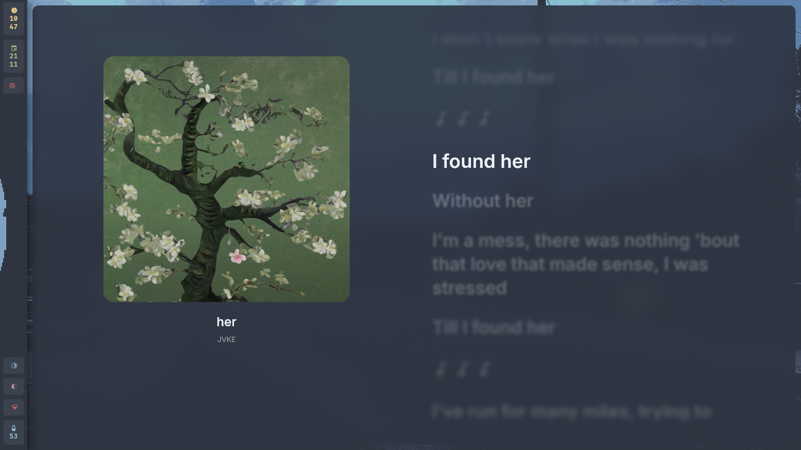

# Nord Niri Dotfiles

Minimal, keyboard-driven Arch Linux desktop configuration built around the **Niri** Wayland compositor and styled with the **Nord** color palette (`#2E3440`, `#88C0D0`, `#ECEFF4`).

## Preview

| Desktop & Waybar | Tofi Launcher |
| :---: | :---: |
|  |  |

## Stack Overview

| Component | Tool | Notes |
| :--- | :--- | :--- |
| **Display Manager** | [Ly](https://github.com/fairyglade/ly) | Minimal TUI login manager with custom Nord TTY palette |
| **Compositor** | [Niri](https://github.com/YaLTeR/niri) | Scrollable-tiling Wayland compositor + native screenshots |
| **Bar** | [Waybar](https://github.com/Alexays/Waybar) | Status bar with `cava` audio visualizer integration |
| **Launcher** | [Tofi](https://github.com/philj56/tofi) | Full-screen, iconless Nord launcher (`tofi-drun`) |
| **Notifications** | [Mako](https://github.com/emersion/mako) | Lightweight Wayland notification daemon |
| **OSD** | [SwayOSD](https://github.com/ErikReider/SwayOSD) | Nord-styled volume, brightness, and lock-key popups |
| **Lock & Idle** | `hyprlock` / `hypridle` | JetBrainsMono Nerd Font clock + Niri DPMS power management |
| **Terminal & Shell** | `kitty` / `fish` | Nord theme with custom aliases and minimal prompt |
| **Editor** | [Neovim](https://neovim.io/) | Vanilla Lua config with Nord palette |
| **File Managers** | `nordend` / `yazi` | Native Wayland GUI + terminal file manager |
| **Media & System** | `mpv`, `cava`, `bottom`, `fastfetch` | VA-API hardware-accelerated media & system monitoring |
| **Theming** | `gtk-3.0`, `gtk-4.0`, `nwg-look`, `xsettingsd` | Unified Nord GTK & XWayland appearance |
| **Portals** | `xdg-desktop-portal-gnome` | PipeWire screen sharing without GTK file-picker overrides |

## Repository Structure

Managed with [GNU Stow](https://www.gnu.org/software/stow/). Each top-level directory mirrors `$HOME` (`~`):

```text
dotfiles/
├── install.sh            # Automated Arch Linux setup & GNU Stow installer
├── bottom/               # System monitor config
├── cava/                 # Audio visualizer config
├── desktop/              # Default application associations (mimeapps.list)
├── fastfetch/            # System fetch layout
├── fish/                 # Fish shell config, aliases, and functions
├── gtk-3.0/              # GTK 3 theme settings
├── gtk-4.0/              # GTK 4 theme settings
├── hypr/                 # hyprlock & hypridle configs
├── kitty/                # Kitty terminal & Nord color scheme
├── mako/                 # Notification daemon styling
├── mpv/                  # Video player settings
├── niri/                 # Niri compositor config & keybinds
├── nordend/              # Nordend file manager config
├── nvim/                 # Neovim Lua configuration
├── nwg-look/             # GTK look settings
├── scripts/              # Custom user scripts (~/.local/bin, battery alerts)
├── swayosd/              # SwayOSD Nord GTK CSS
├── tofi/                 # Tofi launcher config
├── walls/                # Nord wallpapers
├── waybar/               # Waybar layout & CSS
├── xdg-desktop-portal/   # Niri screencast portal routing
├── xsettingsd/           # XWayland theme settings
└── yazi/                 # Terminal file manager config
```

## Installation

### 1. Automated Setup via `install.sh` (Recommended)

The `install.sh` script automates the entire deployment on a fresh Arch Linux installation:
- **Package Installation:** Installs all required official repository packages via `pacman` and bootstraps `paru` (if not already installed) to install AUR packages (`librewolf-bin`, `nordend`, `awww`, `nordic-theme`).
- **Safe Dotfile Symlinking:** Automatically backs up any existing conflicting configuration files to `~/.config-backup-<timestamp>` before symlinking every package into `$HOME` using GNU Stow.
- **Display Manager & TTY Nord Theme:** Configures `/etc/ly/config.ini` and `/etc/ly/startup.sh` so `ly` renders with the true `#2E3440` Nord Polar Night background.
- **Power & System Services:** Enables `ly`, `bluetooth`, `tuned` (set to `powersave`), and a `powertop --auto-tune` systemd service.
- **Default Shell:** Sets `fish` as your default login shell.

Run the script as your normal user (**do not run with `sudo`**; it will prompt for your password when elevated privileges are needed):

```sh
git clone [https://github.com/Zomboy01/dotfiles.git](https://github.com/Zomboy01/dotfiles.git) ~/dotfiles
cd ~/dotfiles
chmod +x install.sh
./install.sh
```

> **Note:** If you use LibreWolf, launch it once to generate your profile directory, then re-run `./install.sh` so it automatically symlinks `userChrome.css` into your profile's `chrome/` folder.

---

### 2. Manual Setup

If you prefer to install components individually:

1. **Install Dependencies (Arch Linux):**
   ```fish
   sudo pacman -S --needed \
     ly niri waybar tofi mako swayosd hyprlock hypridle \
     kitty fish neovim yazi mpv cava bottom fastfetch \
     xdg-desktop-portal xdg-desktop-portal-gnome \
     brightnessctl wl-clipboard ttf-jetbrains-mono-nerd \
     tuned powertop stow git
   ```

2. **Clone & Symlink with GNU Stow:**
   ```fish
   git clone [https://github.com/Zomboy01/dotfiles.git](https://github.com/Zomboy01/dotfiles.git) ~/dotfiles
   cd ~/dotfiles

   # Remove default auto-generated fish config if running inside fish
   rm -f ~/.config/fish/config.fish

   # Symlink all packages into ~
   stow -v */
   ```

3. **Enable System Services:**
   ```fish
   sudo systemctl enable ly.service
   sudo systemctl enable --now tuned.service swayosd-libinput-backend.service
   sudo tuned-adm profile powersave
   ```
